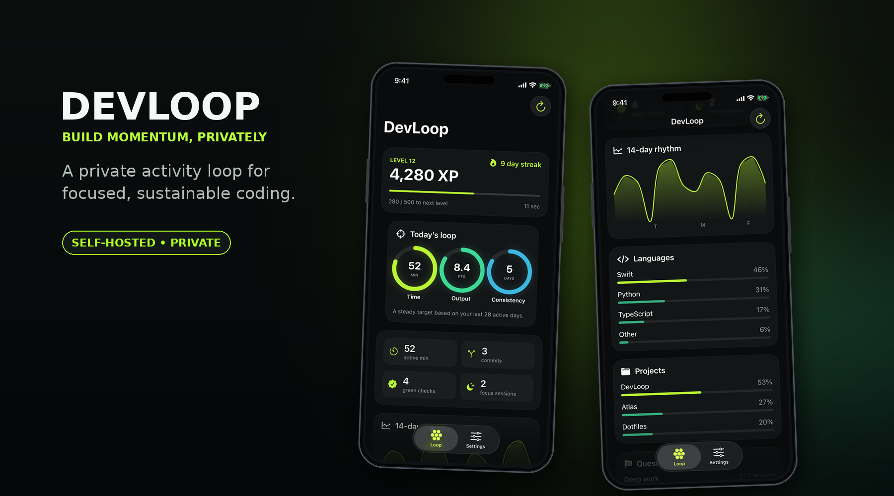
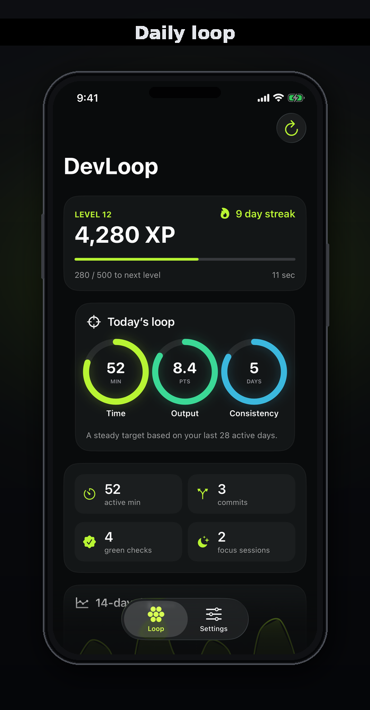
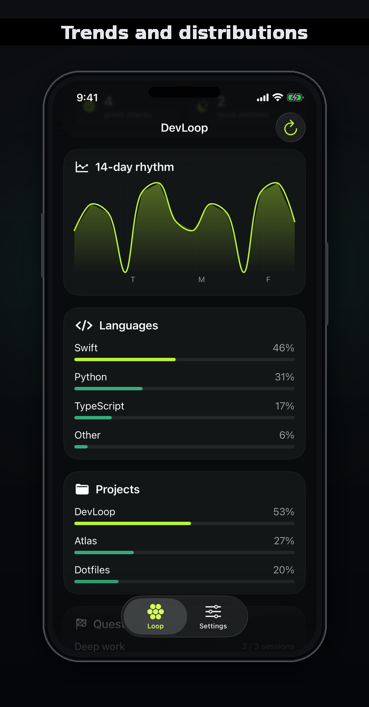

# DevLoop

DevLoop is a self-hosted, privacy-focused coding activity tracker. A small collector sends allow-listed development metadata to a private FastAPI service; a native iPhone app turns that data into Time, Output, and Consistency rings, XP, streaks, trends, and Home Screen/Lock Screen widgets.

DevLoop does **not** collect source code, diffs, terminal commands or output, AI prompts or responses, environment variables, repository remotes, or arbitrary metadata.

<p align="center">
  
</p>

<p align="center"><em>Real SwiftUI screens rendered with synthetic demonstration activity. No private repository or development data is shown.</em></p>

## Interface

<p align="center">
  
  &nbsp;&nbsp;
  
</p>

## What runs where

```text
GitHub public events ─┐
Mac/Linux collectors ├──> private FastAPI API + SQLite ──Tailscale HTTPS──> iPhone app
manual milestones ───┘                                            └──────> WidgetKit cache
```

- **Server:** Python 3.11/3.12, FastAPI, Uvicorn, and SQLite on an always-on Linux or macOS machine.
- **Collector:** dependency-free Python CLI on any Mac/Linux machine that records events.
- **GitHub poller:** optional collector command that imports public push activity every 15 minutes.
- **iPhone:** native SwiftUI app and WidgetKit extension. Credentials live in Keychain; aggregate widget data lives in a shared App Group container.
- **Tailscale:** recommended private network and HTTPS termination. The API deliberately refuses wildcard, LAN, and public bind addresses.
- **Build Mac:** required to generate, sign, test, and install the iOS app. It is not needed during normal operation.

## Repository layout

- `server/` — private API, SQLite persistence, analytics, scoring, and dashboard aggregation.
- `collector/` — typed CLI events, retry spool, Git metadata, and GitHub public-event polling.
- `ios/` — SwiftUI app, WidgetKit extension, shared cache, tests, and XcodeGen specification.
- `deploy/` — example server/collector configuration and systemd units.
- `docs/architecture.md` — privacy boundary, event contract, and scoring model.
- `shared/` — sanitized API examples.

## Prerequisites

### Server/collector host

- Linux or macOS that can remain online.
- Python 3.11 or 3.12.
- [`uv`](https://docs.astral.sh/uv/getting-started/installation/).
- [Tailscale](https://tailscale.com/download) logged into the same tailnet as the iPhone.
- systemd user services for the included service templates; launchd, Docker, or another supervisor can be substituted.

### iOS build

- A Mac with Xcode 15 or newer and the iOS 17 SDK.
- [XcodeGen](https://github.com/yonaskolb/XcodeGen): `brew install xcodegen`.
- An iPhone running iOS 17 or newer with Developer Mode enabled.
- An Apple Developer team capable of registering App IDs and App Groups. A paid Apple Developer Program membership is the reliable path for App Groups and durable device provisioning.

## 1. Clone and install dependencies

The service templates assume the repository is at `~/devloop`. If you clone elsewhere, edit their `WorkingDirectory` and `ExecStart` paths.

```bash
git clone https://github.com/Cammm123/DevLoop.git ~/devloop
cd ~/devloop

cd server
uv sync --dev
uv run pytest

cd ../collector
uv sync --dev
uv run pytest
```

## 2. Create the shared API token

Generate one random token and use the same value for the server, every collector, and the iPhone app. Do not commit it or put it directly in a systemd unit.

```bash
mkdir -p ~/.config/devloop ~/.local/share/devloop ~/.local/state/devloop
chmod 700 ~/.config/devloop ~/.local/share/devloop ~/.local/state/devloop

python3 -c 'import secrets; print(secrets.token_urlsafe(32))'
cp ~/devloop/deploy/server.env.example ~/.config/devloop/server.env
chmod 600 ~/.config/devloop/server.env
```

Edit `~/.config/devloop/server.env` and replace the placeholder:

```dotenv
DEVLOOP_API_TOKEN=YOUR_RANDOM_TOKEN
DEVLOOP_DATABASE_PATH=/home/YOUR_USER/.local/share/devloop/devloop.sqlite3
DEVLOOP_BIND_HOST=127.0.0.1
DEVLOOP_BIND_PORT=8765
```

Use an absolute database path. systemd does not expand `$HOME` or `~` inside an environment file.

## 3. Run the private API

### Quick foreground test

```bash
cd ~/devloop/server
set -a
. ~/.config/devloop/server.env
set +a
uv run uvicorn devloop_server.app:create_app --factory \
  --host "$DEVLOOP_BIND_HOST" \
  --port "$DEVLOOP_BIND_PORT" \
  --no-server-header
```

In another terminal:

```bash
curl --fail http://127.0.0.1:8765/health
```

### Persistent systemd user service

```bash
mkdir -p ~/.config/systemd/user
cp ~/devloop/deploy/systemd/devloop-server.service ~/.config/systemd/user/
systemctl --user daemon-reload
systemctl --user enable --now devloop-server.service
systemctl --user status devloop-server.service
```

The included unit assumes `~/devloop` and allows writes only to `~/.local/share/devloop`. Enable user lingering if the service must start before login:

```bash
sudo loginctl enable-linger "$USER"
```

## 4. Expose the API privately with Tailscale HTTPS

Keep Uvicorn on loopback and let Tailscale terminate HTTPS:

```bash
sudo tailscale up
sudo tailscale serve --bg --https=9443 http://127.0.0.1:8765
tailscale serve status
```

The output provides a tailnet-only URL similar to:

```text
https://your-device.your-tailnet.ts.net:9443
```

Verify it from another device on the same tailnet:

```bash
curl --fail https://your-device.your-tailnet.ts.net:9443/health
```

Do not use Tailscale Funnel for this service. Funnel makes a service publicly reachable; DevLoop is designed for a private tailnet.

If Tailscale Serve is unavailable, bind the API directly to the host's literal Tailscale IP and use that address. Plain HTTP is accepted only for loopback or literal Tailscale addresses; normal DNS names require HTTPS.

## 5. Configure the collector

```bash
cp ~/devloop/deploy/config.toml.example ~/.config/devloop/config.toml
chmod 600 ~/.config/devloop/config.toml
```

Edit it with the Tailscale HTTPS origin and the same API token:

```toml
[collector]
api_url = "https://your-device.your-tailnet.ts.net:9443"
token = "YOUR_RANDOM_TOKEN"
timeout_seconds = 5
```

Send a safe test event:

```bash
~/devloop/collector/.venv/bin/devloop heartbeat \
  --duration 1 \
  --project DevLoopSetup \
  --file verification.py \
  --language Python \
  --editor Terminal
```

Useful commands include:

```bash
devloop git-snapshot --repo "$PWD"
devloop git-commit --repo "$PWD"
devloop test-result --success --duration 12 --project myapp --tool pytest --count 42
devloop build-result --success --duration 45 --project myapp --tool xcodebuild
devloop milestone --title "First private sync" --project myapp
devloop retry
```

See [`collector/README.md`](collector/README.md) for shell heartbeat hooks and the fixed-schema stdin interface.

## 6. Optional: track public GitHub pushes

One manual synchronization:

```bash
~/devloop/collector/.venv/bin/devloop github-sync --username YOUR_GITHUB_USERNAME
```

For a 15-minute systemd timer:

```bash
mkdir -p ~/.config/systemd/user
cp ~/devloop/deploy/systemd/devloop-github-sync.{service,timer} ~/.config/systemd/user/

# Replace the placeholder username in the copied service.
python3 - <<'PY'
from pathlib import Path
path = Path.home() / ".config/systemd/user/devloop-github-sync.service"
path.write_text(path.read_text().replace("REPLACE_WITH_GITHUB_USERNAME", "YOUR_GITHUB_USERNAME"))
PY

systemctl --user daemon-reload
systemctl --user enable --now devloop-github-sync.timer
systemctl --user start devloop-github-sync.service
systemctl --user status devloop-github-sync.timer
journalctl --user -u devloop-github-sync.service --no-pager
```

The unauthenticated GitHub public-events feed exposes public pushes only and currently redacts the exact number of commits in each push. DevLoop therefore records one conservative `commit` event per push. It stores only a deterministic event ID, timestamp, repository basename, branch, and magnitude. It never retains commit messages, authors, diffs, changed files, or source code.

Repeated polls are safe: a private mode-0600 cursor and deterministic server event IDs prevent duplicate scoring. Private repository tracking is not enabled. If authenticated access is added later, keep `GITHUB_TOKEN` in a secret manager or protected service environment—not in this repository or the command line.

## 7. Customize the iOS identifiers

The checked-in XcodeGen file contains the original developer's identifiers as working examples. Every fork must use unique identifiers owned by its Apple Developer team.

Choose values such as:

```text
Team ID:              ABCDE12345
App bundle ID:        com.yourname.devloop
Widget bundle ID:     com.yourname.devloop.widgets
Test bundle ID:       com.yourname.devloop.tests
App Group:            group.com.yourname.devloop
Keychain service:     com.yourname.devloop.credentials
```

Replace the originals in all of these locations:

1. `ios/project.yml`
   - `bundleIdPrefix`
   - `DEVELOPMENT_TEAM`
   - all three `PRODUCT_BUNDLE_IDENTIFIER` values
2. `ios/DevLoop/Resources/DevLoop.entitlements`
3. `ios/Widgets/Resources/DevLoopWidgets.entitlements`
4. `ios/Shared/Storage/DashboardCache.swift` (`DashboardCache.appGroup`)
5. `ios/DevLoop/Services/CredentialStore.swift` (`service`)

A quick audit should return only your values:

```bash
cd ~/devloop
grep -R "com.cameronkani\|CLZCN5NC8V" \
  ios/project.yml ios/DevLoop ios/Widgets ios/Shared || true
```

## 8. Register Apple App IDs and the App Group

In the [Apple Developer Certificates, Identifiers & Profiles portal](https://developer.apple.com/account/resources/identifiers/list):

1. Register an **App Group** matching your chosen `group.com.yourname.devloop` value.
2. Register or select the main App ID, for example `com.yourname.devloop`.
3. Enable the **App Groups** capability and attach the App Group.
4. Register or select the widget App ID, for example `com.yourname.devloop.widgets`.
5. Enable the **App Groups** capability and attach the same App Group.
6. Accept any pending Apple Developer Program agreements.
7. Let Xcode automatic signing create or refresh both provisioning profiles.

Registering the App Group alone is not enough—it must be attached to both App IDs. The app and widget must contain the exact same App Group entitlement or the widget cache will be unavailable.

## 9. Generate, test, sign, and install the iOS app

```bash
cd ~/devloop/ios
brew install xcodegen
xcodegen generate
open DevLoop.xcodeproj
```

In Xcode:

1. Select the `DevLoop` project and confirm your team under **Signing & Capabilities** for the app and widget targets.
2. Confirm the App Groups capability shows the same checked group on both targets.
3. Connect and unlock the iPhone.
4. Enable Developer Mode on the iPhone if prompted.
5. Select the iPhone as the run destination.
6. Run the `DevLoop` scheme.

Run simulator tests from the command line:

```bash
xcodebuild \
  -project DevLoop.xcodeproj \
  -scheme DevLoop \
  -destination 'platform=iOS Simulator,name=iPhone 16' \
  test
```

Use any installed simulator name reported by `xcrun simctl list devices available`.

## 10. Connect the iPhone app

1. Install Tailscale on the iPhone and join the same tailnet.
2. Open DevLoop.
3. Enter the Tailscale HTTPS URL from step 4.
4. Enter the same bearer token used by the server and collector.
5. Save and refresh.
6. Add the DevLoop Home Screen and/or Lock Screen widgets.

The URL and token are stored in the iPhone Keychain. After a successful refresh, the app writes only the aggregate `DashboardSnapshot` to the shared App Group. Widgets read that cache; they do not receive or store the bearer token.

## 11. End-to-end verification

Check every layer instead of assuming an installation succeeded:

```bash
# API process
systemctl --user is-active devloop-server.service
curl --fail http://127.0.0.1:8765/health

# Private HTTPS route
curl --fail https://your-device.your-tailnet.ts.net:9443/health

# Event ingestion
~/devloop/collector/.venv/bin/devloop heartbeat \
  --duration 1 --project Verification --file check.py --language Python --editor Terminal

# GitHub timer, if enabled
systemctl --user is-enabled devloop-github-sync.timer
systemctl --user is-active devloop-github-sync.timer
journalctl --user -u devloop-github-sync.service --since today --no-pager
```

Then refresh the iPhone app and confirm the new activity appears. If a widget was installed before App Group provisioning was corrected, remove and re-add it to clear the stale WidgetKit timeline.

## Operations

### Logs

```bash
journalctl --user -u devloop-server.service -f
journalctl --user -u devloop-github-sync.service --since today --no-pager
```

### Database backup

Use SQLite's online backup command while the service is running:

```bash
mkdir -p ~/backups/devloop
sqlite3 ~/.local/share/devloop/devloop.sqlite3 \
  ".backup '$HOME/backups/devloop/devloop-$(date +%F).sqlite3'"
```

Protect backups like the original database; they contain activity metadata.

### Upgrade

```bash
cd ~/devloop
git pull --ff-only
(cd server && uv sync)
(cd collector && uv sync)
systemctl --user restart devloop-server.service
systemctl --user start devloop-github-sync.service  # if enabled
```

Regenerate and reinstall the iOS app whenever `ios/` changes.

## Troubleshooting

### API refuses to start

- `DEVLOOP_API_TOKEN` must contain at least 32 characters.
- `DEVLOOP_BIND_HOST` must be localhost, a loopback address, or a literal Tailscale address.
- Use an absolute writable database path when starting through systemd.

### Collector rejects the API URL

- Use HTTPS for DNS names.
- Plain HTTP is permitted only for loopback or literal Tailscale IP addresses.
- Do not put credentials, query parameters, or fragments in `api_url`.

### Provisioning profile lacks the App Group

Enable the same App Group on both App IDs in the Apple Developer portal, regenerate profiles, regenerate the Xcode project, and rebuild. Merely creating the App Group does not attach it to an App ID.

### `codesign` reports `errSecInternalComponent`

This commonly occurs when signing from SSH and the private key is available only to the logged-in macOS desktop Keychain session. Build from Xcode or a Terminal window in the active desktop session.

### Lock Screen widget says “Please adopt containerBackground”

Current source already uses `containerBackground(for: .widget)` for accessory widgets. Rebuild/reinstall the latest app, then remove and re-add the widget if iOS retained an older extension snapshot.

### Widget says “Open DevLoop to sync”

Open the app, verify the server URL/token, refresh successfully, and confirm both targets use the exact same App Group. Widgets display the app's last cached aggregate snapshot.

## Privacy and security model

Allowed event fields are fixed and validated: timestamp, opaque device/event IDs, source, event kind, bounded duration, sanitized project/file/language/tool/branch labels, success, and small aggregate counts. Unknown keys are rejected.

Explicitly forbidden and not represented in the event schema:

- source contents and diffs
- terminal command text or output
- AI prompts or responses
- environment variables and credentials
- repository remotes
- arbitrary JSON metadata or blobs

Additional safeguards:

- Bearer authentication on every `/v1/*` endpoint.
- Idempotent event UUIDs.
- Request and batch-size limits.
- Private local file permissions.
- Keychain storage on iPhone.
- Tailnet-only deployment by default.
- Aggregate-only dashboard responses.

Read [`docs/architecture.md`](docs/architecture.md) for the complete event and scoring model.

## Tests

```bash
(cd server && uv run pytest)
(cd collector && uv run pytest)

# On a Mac after `xcodegen generate`:
cd ios
xcodebuild -project DevLoop.xcodeproj -scheme DevLoop \
  -destination 'platform=iOS Simulator,name=iPhone 16' test
```

## License

MIT. See [`LICENSE`](LICENSE).
